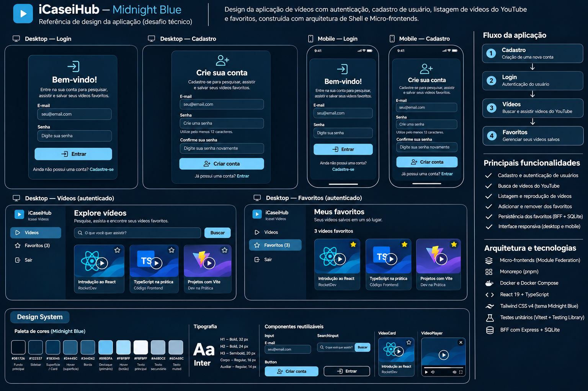

# iCasei — Desafio Front-End 2026

Aplicação de pesquisa e reprodução de vídeos do YouTube, com autenticação e favoritos persistentes. O projeto foi desenvolvido para o [desafio de Front-End da iCasei](https://github.com/icasei/teste-front-end-2026), utilizando uma arquitetura de micro-frontends com um BFF compartilhado.

## Funcionalidades

- **Autenticação:** cadastro de conta pela interface, login, verificação de sessão, rotas protegidas e logout.
- **Pesquisa de vídeos:** busca pela YouTube Data API v3 e reprodução dos resultados.
- **Favoritos:** adição, listagem e remoção de vídeos, com persistência por usuário no SQLite.
- **Contador sincronizado:** quantidade de favoritos atualizada no menu após alterações.
- **Navegação:** acesso direto às rotas `/videos` e `/favorites`.
- **Interface responsiva:** layout adaptável, estados de carregamento, erro e lista vazia.
- **Mocks:** possibilidade de desenvolver a interface sem consumir a API real.

## Design visual e telas de referência

A interface utiliza o tema **Midnight Blue — iCasei Edition**, documentado com base nos componentes e nos tokens CSS da implementação. O material reúne as telas de **login, cadastro, pesquisa e favoritos**, versões responsivas, estilos, textos e estados de interface.



- [Guia de design, paleta, tipografia, componentes e textos](docs/DESIGN.md)
- [Prévia estática em HTML](docs/design-reference.html)
- [Imagem de prévia da referência HTML](docs/design-reference-preview.png)
- [Checklist de validação da entrega](docs/VALIDACAO.md)

## Tecnologias

| Camada           | Tecnologias                                             |
| ---------------- | ------------------------------------------------------- |
| Front-end        | React 19, TypeScript, Vite 8, React Router              |
| Micro-frontends  | Module Federation (`@module-federation/vite`)           |
| Estilos e ícones | Tailwind CSS 4, Lucide React                            |
| BFF              | Node.js, Express 5, Zod                                 |
| Persistência     | SQLite (`node:sqlite`)                                  |
| Autenticação     | Argon2id, sessões armazenadas no BFF e cookies HttpOnly |
| Testes           | Vitest, React Testing Library, Supertest                |
| Monorepo         | pnpm workspaces                                         |
| Containers       | Docker Compose, build multi-stage e Nginx               |

## Arquitetura

```text
                      Navegador
                         |
                   Shell (:5173)
                 React Router / Host
                    /          \
                   /            \
         MF_DRAWER (:5174)   MF_VIDEOS (:5175)
              Menu           Busca / Favoritos
                   \            /
                    \          /
                 /api (proxy do Shell)
                         |
                    BFF (:3000)
                    Express / Auth
                      /      \
                     /        \
                  SQLite    YouTube API
```

O **Shell** compõe a aplicação, controla as rotas e a autenticação e carrega os remotes com Module Federation. O **MF_DRAWER** apresenta a navegação e o contador de favoritos. O **MF_VIDEOS** implementa a busca, reprodução e gerenciamento dos favoritos.

Um único **BFF** centraliza autenticação, consumo da API do YouTube e persistência. Essa escolha evita duplicar regras e permite compartilhar a sessão entre as funcionalidades.

### Organização do monorepo

```text
apps/
  shell/            # Host, login, cadastro, proteção de rotas e layout
  mf-drawer/        # Menu e navegação
  mf-videos/        # Pesquisa, player e favoritos
  bff/              # API Express, autenticação e SQLite
packages/
  contracts/        # Tipos e contratos compartilhados
  hooks/            # Hook useFetch compartilhado
  theme/            # Tokens de tema
wireframe/          # Referências do desafio
docs/               # Guia visual, telas, tokens e checklist de validação
docker-compose.yaml
pnpm-workspace.yaml
```

## Executar com Docker (recomendado)

### Pré-requisitos

- Docker com o plugin Docker Compose.
- Uma chave válida para a **YouTube Data API v3**. Consulte [a documentação do YouTube](https://developers.google.com/youtube/v3/getting-started).

### 1. Configurar o ambiente

Na raiz do projeto:

```bash
cp apps/bff/.env.example apps/bff/.env
```

Preencha `YOUTUBE_API_KEY` em `apps/bff/.env` com sua própria chave. As outras variáveis já têm valores de exemplo; no Docker, porta e caminho do banco são configurados pelo Compose. A chave é necessária para a busca real de vídeos, não para o cadastro.

**Não versione arquivos `.env` nem compartilhe a chave da API.** A chave fica no BFF e não é enviada para o navegador.

### 2. Subir a aplicação

```bash
docker compose config --quiet
docker compose up -d --build
docker compose ps
```

Abra **http://localhost:5173/register** para criar uma conta. Se você já tiver uma conta, acesse **http://localhost:5173/login**.

> **Importante:** o `docker-compose.yaml` deve declarar os quatro serviços (`bff`, `shell`, `mf-drawer` e `mf-videos`). Confira a configuração do seu clone com `docker compose config --services` antes da execução.

| Serviço   | Endereço local        | Responsabilidade     |
| --------- | --------------------- | -------------------- |
| Shell     | http://localhost:5173 | Entrada da aplicação |
| MF_DRAWER | http://localhost:5174 | Remote de navegação  |
| MF_VIDEOS | http://localhost:5175 | Remote de vídeos     |
| BFF       | http://localhost:3000 | API e persistência   |

Os três front-ends são compilados pelo Vite e servidos pelo Nginx. O Nginx do Shell encaminha `/api` para o BFF pela rede interna do Compose.

### 3. Criar uma conta pela interface

O avaliador **não precisa de conta pré-cadastrada nem de comandos `curl`**. O banco pode começar vazio.

1. Abra **http://localhost:5173/register** (ou clique em **Cadastre-se** na tela de login).
2. Preencha o **E-mail**, a **Senha** (de **12 a 128 caracteres**) e **Confirme sua senha**.
3. Clique em **Criar conta**. Se as senhas forem diferentes, o formulário mostra uma mensagem; se o e-mail já estiver cadastrado, a API retorna erro tratado na interface.
4. Após o sucesso, a aplicação redireciona para **`/login`**. Entre com os dados recém-criados; o cadastro não autentica automaticamente.
5. Acesse **Vídeos**, faça uma pesquisa, reproduza um vídeo, adicione-o aos **Favoritos**, atualize a página e confirme que o favorito e o contador continuam disponíveis.

> A busca de vídeos requer a chave válida da API do YouTube. O cadastro e o login são processados pelo BFF, e as senhas não ficam gravadas em texto puro no banco.

### 4. Checagem rápida de funcionamento

```bash
docker compose ps
curl -fsS http://localhost:5173/api/health
curl -I http://localhost:5174/remoteEntry.js
curl -I http://localhost:5175/remoteEntry.js
```

O endpoint de saúde deve responder sem erro; os dois `remoteEntry.js` devem retornar HTTP `200`. Isso valida a disponibilidade básica dos serviços, **não substitui** testar cadastro, login e favoritos no navegador.

### Comandos úteis

```bash
docker compose ps                 # Status dos containers
docker compose logs -f bff        # Logs da API
docker compose logs -f shell      # Logs do host
docker compose up -d --build      # Reconstrói após alterações
docker compose down               # Encerra e remove os containers
```

O SQLite utiliza um volume nomeado (`bff-data`), portanto os favoritos permanecem após reiniciar ou recriar os containers. **Evite `docker compose down -v`** se quiser preservar os dados, pois esse comando também remove o volume.

## Desenvolvimento local (sem Docker)

Pré-requisitos: **Node.js 24** e **pnpm 10.34.9** (versão indicada no `package.json` da raiz).

```bash
pnpm install
cp .env-example .env
cp apps/bff/.env.example apps/bff/.env
```

Configure a chave do YouTube no `.env` do BFF. No `.env` da raiz, utilize:

```dotenv
VITE_USE_MOCKS=false
```

Em **quatro terminais separados**, a partir da raiz do projeto:

```bash
pnpm --filter @icasei/bff dev
pnpm --filter mf-drawer dev
pnpm --filter mf-videos dev
pnpm --filter shell dev
```

Acesse **http://localhost:5173/register** para criar a conta (ou `/login` se já possuir cadastro). No desenvolvimento, o Vite do Shell encaminha as chamadas `/api` para `127.0.0.1:3000`.

### Modo mock

Para testar os fluxos de interface sem depender do BFF, altere o `.env` da raiz:

```dotenv
VITE_USE_MOCKS=true
```

Reinicie os servidores Vite após a alteração. Os controllers selecionam a implementação mock ou o serviço HTTP conforme essa variável. O mock de autenticação simula a sessão; o mock de favoritos utiliza armazenamento local exclusivamente para desenvolvimento. O cadastro é persistente apenas no modo real, com BFF e SQLite (no mock, confirme o comportamento na implementação local). **No modo real, a fonte de verdade é o BFF/SQLite.**

Na execução Docker descrita acima, os front-ends são compilados com `VITE_USE_MOCKS=false`.

## Testes, lint e builds

Na raiz do monorepo:

```bash
# Testes
pnpm --filter shell test
pnpm --filter mf-drawer test
pnpm --filter mf-videos test
pnpm --filter @icasei/bff test

# Lint dos front-ends
pnpm --filter shell lint
pnpm --filter mf-drawer lint
pnpm --filter mf-videos lint

# Verificação de tipos do BFF
pnpm --filter @icasei/bff typecheck

# Builds
pnpm --filter shell build
pnpm --filter mf-drawer build
pnpm --filter mf-videos build
pnpm --filter @icasei/bff build

# Formatação
pnpm format:check
```

Os testes contemplam componentes de interface e fluxos de autenticação, além de rotas do BFF, incluindo favoritos, validação e isolamento por usuário. Execute os comandos acima para conferir os resultados e totais da versão efetivamente entregue; testes adicionados localmente podem ainda não ter sido publicados.

## API do BFF

| Método   | Rota                       | Finalidade                  |
| -------- | -------------------------- | --------------------------- |
| `GET`    | `/api/health`              | Verificar saúde da API      |
| `POST`   | `/api/auth/register`       | Cadastrar usuário           |
| `POST`   | `/api/auth/login`          | Iniciar sessão              |
| `GET`    | `/api/auth/me`             | Verificar sessão            |
| `POST`   | `/api/auth/logout`         | Encerrar sessão             |
| `GET`    | `/api/videos/search?q=...` | Pesquisar vídeos no YouTube |
| `GET`    | `/api/favorites`           | Listar favoritos do usuário |
| `POST`   | `/api/favorites`           | Adicionar favorito          |
| `DELETE` | `/api/favorites/:videoId`  | Remover favorito            |

As rotas de vídeos e favoritos exigem autenticação. As requisições do front-end utilizam `credentials: "include"` para enviar o cookie de sessão.

## Decisões técnicas

**Module Federation.** O Shell carrega MF_DRAWER e MF_VIDEOS como remotes independentes. Os componentes federados são carregados com `React.lazy`/`Suspense` e protegidos por um `MicroFrontendErrorBoundary`. O boundary é um componente de classe porque a API nativa de error boundaries do React utiliza `getDerivedStateFromError` e `componentDidCatch`.

**BFF único.** As chamadas ao YouTube e ao SQLite passam pelo Express. Isso concentra autenticação, validação e regras de negócio e impede a exposição da chave do YouTube no bundle do front-end.

**Persistência e autenticação.** As senhas são protegidas com Argon2id, e as sessões utilizam cookies HttpOnly. Os favoritos ficam vinculados ao usuário no SQLite, permitindo atualização da página sem perder os dados.

**Controllers e `useFetch`.** A interface chama funções de controller por meio de um hook compartilhado que centraliza `data`, `loading`, `error`, cancelamento e callbacks `onSuccess`/`onError`. Os controllers direcionam as chamadas para mocks ou para a API real, sem colocar essa decisão nos componentes.

**Comunicação entre micro-frontends.** O MF_VIDEOS publica o evento `icasei:favorites-updated` após recuperar a contagem confirmada pela API. O Shell escuta o evento e passa a quantidade ao MF_DRAWER por props. Não há importação direta entre os dois remotes.

**Componentização.** O `Input` compartilhado mantém os formulários de login e cadastro consistentes. `VideoCard`, `VideoList`, `VideoPlayer` e `EmptyState` são reutilizados nas telas de vídeos e favoritos para evitar duplicação de interface e facilitar os testes.

## Observações

- O projeto foi executado localmente com quatro serviços no Docker Compose. Antes da entrega, repita o checklist de [validação](docs/VALIDACAO.md) na versão que será enviada ao avaliador; a consulta ao GitHub não substitui uma execução local.
- A configuração local usa HTTP e portas em `localhost`; não é uma implantação pública com HTTPS.
- O modo mock é uma ferramenta de desenvolvimento, não uma solução de autenticação para produção.
- A YouTube Data API possui cotas e exige uma chave válida para buscas reais.
- O cadastro é uma funcionalidade complementar ao enunciado, adicionada para o avaliador conseguir usar a aplicação de forma independente.

## Referências

- [Enunciado original — iCasei](https://github.com/icasei/teste-front-end-2026)
- [YouTube Data API v3](https://developers.google.com/youtube/v3/docs/search/list)
